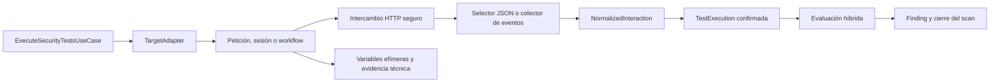

# Roadmap de protocolos para targets LLM

Este índice organiza los próximos cinco changes. Los artefactos iniciales de generalize-target-integration conservan el contexto histórico de la epic. Las cinco propuestas enlazadas definen el alcance prospectivo de cada incremento. La aprobación e implementación se decide por change.

## Arquitectura

Mantener TargetAdapter como puerto de una interacción por prueba. El adapter elegido puede resolver una petición, una sesión de dos llamadas o un plan de pasos. Los intercambios comparten el transporte seguro. Los eventos, variables y credenciales temporales quedan en el lado de infraestructura. El adapter entrega una única NormalizedInteraction. La proyección actual produce TestExecution y la evaluación usa el texto final saneado. Los estados, las cuatro pruebas y la confirmación de scoring-v1/report-v1 siguen su contrato vigente.

| Contrato | Responsabilidad |
|---|---|
| TargetAdapter | Firma existente con target, prompt y ScanBudget |
| InteractionEvent | DTO interno con orden local, tipo, texto delta/snapshot opcional y terminal/error. Extensión posterior para observaciones retrieval/tools |
| InteractionSession | Contexto efímero por TestExecution. Declara tipos, procedencia y alcance de variables |
| WorkflowExecution | Estado interno de pasos, presupuesto global y diagnóstico acotado durante una interacción |
| NormalizedInteraction | Resultado final compatible con el contrato actual, incluido fallo técnico. Los parciales y eventos jamás son una respuesta evaluable |
| Plan de integración | JSON operativo validado y versionado, ligado a proyecto, target y configuración vigente |

InteractionAdapter duplicaría el propósito de TargetAdapter. El diseño amplía sus implementaciones y extrae el intercambio HTTP común según las necesidades de cada incremento.

### Configuración, datos y compatibilidad

Proponer un manifiesto JSON local de operador, separado de la API pública. Cada binding requiere projectId, targetConfigurationId y targetUpdatedAt exactos de un target REST_LEGACY autorizado. Reutiliza URL/origen, timeout y credencial estática del target. El worker resuelve una copia validada al preparar el plan, antes de confirmar ejecuciones y antes de red. Los perfiles compuestos extienden el plan interno, sin editar TargetConfiguration ni enviar valores a través de DTO públicos. Un binding malformado, ambiguo o desactualizado bloquea el uso de esa integración con diagnóstico cerrado. Si el operador retira explícitamente un binding, el siguiente scan vuelve al comportamiento normal del tipo configurado. La revisión del manifiesto no acredita por sí sola que el target remoto permanezca igual.

El transporte conserva el body JSON saneado del intercambio terminal en el campo existente y usa su HTTP status real. En fallo conserva únicamente metadata segura y evidencia permitida, sin fabricar 2xx, body de petición o texto completo. Las trazas por paso son metadata efímera y logs estructurados acotados. No se amplían el payload de report-v1 ni el schema SQL de ejecuciones. Los cambios se prueban con REST_LEGACY y OPENAI_COMPATIBLE sin manifiesto, ambos perfiles híbridos, Findings históricos y cierre atómico de score/informe. API/frontend pueden incorporar edición operativa en una propuesta posterior si se aprueba. El alcance histórico de report-v1 sigue describiendo las pruebas y criterios del informe, aunque haya capacidades de transporte o diagnósticos técnicos adicionales.

### Controles compartidos

Cada exchange aplica allowlist exacta, validación de todas las IP resueltas, conexión fijada a una IP validada, TLS del hostname, cero redirects y autorización previa al uso de credenciales. Mantener bloqueo de redes privadas y metadata según la política vigente. El presupuesto monotónico incluye DNS, cuota, transporte y parsing, con cotas por petición y acumuladas por interacción y scan. La red se ejecuta fuera de transacciones de BD. Una interrupción cierra el intercambio activo y descarta el contexto. Cero retries automáticos. Las peticiones que se añadan consumen la cuota vigente y quedan sujetas a autorización del operador. Un timeout de lectura no garantiza que el proveedor deje de generar o facturar.

Los logs admiten IDs locales, ordinales, códigos, tiempos y contadores. Los diagnósticos por paso excluyen frames brutos, URLs renderizadas, variables, headers, cookies y secretos. La evidencia final aplica la redacción de los mecanismos actuales y de los valores sensibles conocidos en la interacción. La salida compuesta se redacta después de ensamblarla para detectar coincidencias que crucen deltas. Los permisos de exportación a evaluación siguen siendo independientes y conservan corpus exacto y contexto sintético.

## Roadmap y dependencias

| Orden | Change | Dependencias de implementación | Aplicación que desbloquea | Aceptación mínima |
|---|---|---|---|---|
| 1 | [add-streaming-sse-support](../add-streaming-sse-support/proposal.md) | Transporte HTTP actual. Independiente del change 2 | POST JSON cuya respuesta llega por SSE o JSONL | El Accept del binding negocia el stream y permite reconstruir el texto exacto. Las colisiones sensibles de Accept se rechazan antes de red |
| 2 | [add-session-and-dynamic-variables](../add-session-and-dynamic-variables/proposal.md) | Transporte HTTP actual. Puede desarrollarse con fixtures JSON sin el change 1 | Bootstrap de sesión y posterior POST JSON con un identificador | Dos intercambios, mismo origen y variables efímeras por prueba. Headers/cookies se pueden capturar con ámbito, con envío reservado al change 4 |
| 3 | [add-multistep-workflows](../add-multistep-workflows/proposal.md) | 1 y 2 | Chat y sesión mediante JSON completo y POST de prompt con respuesta terminal JSON/SSE/JSONL | La fixture encadena chatId y sessionId y reconstruye el final. El flujo bloquea otro origen antes de red y de materializar credenciales aunque esté en allowlist |
| 4 | [add-dynamic-headers-and-cookies](../add-dynamic-headers-and-cookies/proposal.md) | 2 y 3 | Workflows que requieren cookies y CSRF por paso | Aplicación de sesión autorizada recibe solo bindings previstos. Cambio de origen, redirects y cookies inválidas quedan bloqueados |
| 5 | [add-rag-and-tool-aware-testing](../add-rag-and-tool-aware-testing/proposal.md) | 1 para eventos. Reutiliza 3 o 4 si el target necesita workflow o autenticación derivada | Targets controlados con trazas estructuradas de retrieval y tools | Fixture que distingue retrieval, solicitud, resultado y respuesta final. Comprueba política declarada sin despachar herramientas |

El orden reduce dependencias y permite revisar cada change por separado. ColoqIA se usa como referencia aportada. Las rutas reales de bootstrap, los campos, eventos y terminal todavía requieren confirmación. El caso arquitectónico usa un origen autorizado, crea chat, extrae chatId, crea sesión, extrae sessionId, hace POST /answer con Bearer, recompone la respuesta y entrega un único texto a evaluación. El change 4 solo entra si el contrato real requiere credenciales derivadas. El change 5 requiere telemetría del target y no forma parte de esa aceptación.

## Decisiones abiertas

- Confirmar en una sesión de prueba autorizada el contrato de ColoqIA, su origen, el evento terminal y si usa cookies además de Bearer.
- Confirmar los topes propuestos de frames, eventos y solicitudes con fixtures representativas y límites del propietario. La propuesta reutiliza las cotas de texto, evidencia y tiempo vigentes.
- Confirmar qué trazas sintéticas exponen los targets de RAG/tools y qué ids o aliases puede declarar el propietario. Cualquier nueva regla con Findings o score propios exige otro change.
- La edición por API/UI puede revisarse cuando se disponga de configuraciones de operador verificadas. La activación inicial de los cinco cambios se diseña mediante configuración local.

Primera revisión recomendada: add-streaming-sse-support. Desbloquea un protocolo completo de una sola petición y permite comprobar parsing, cancelación, redacción y compatibilidad antes de añadir estado.
